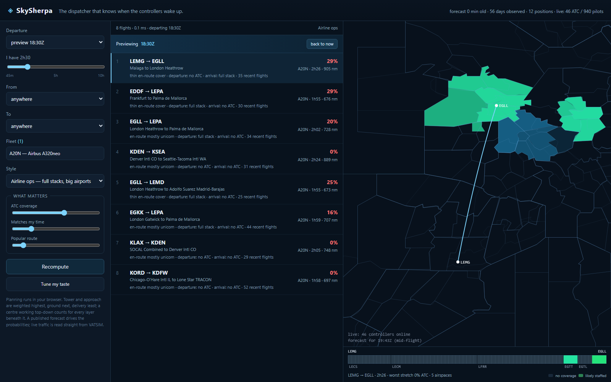
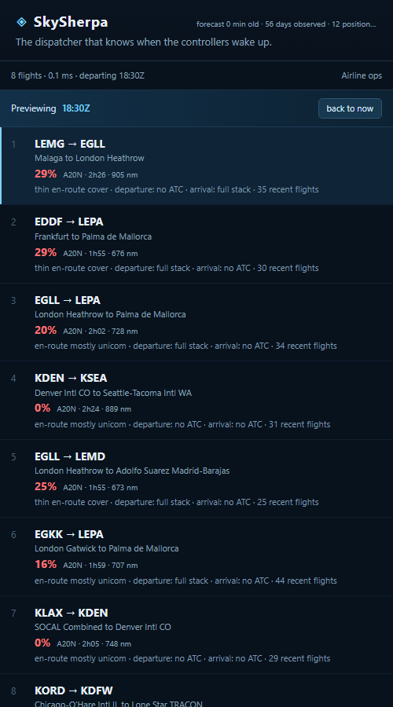

# SkySherpa

**A dispatcher for the VATSIM network.**

> "I have three hours, these airports, these aircraft — where should I fly *tonight*?"

SkySherpa answers that. Not with a route, and not with a mood board. With a ranked,
explainable, probability-weighted set of flights, built from continuous observation of who is
controlling where, when they actually show up, what everyone else is flying, and what the sky
is doing.

---

## The bet

On a virtual network, the route is the easy part — SimBrief already solved it, better than we
ever will. What nobody solves is **timing**: whether a human is on frequency for the forty
minutes you actually need them, at the airport you actually want, on the evening you actually
have free time.

ATC coverage is not random. It is a *schedule*: thousands of volunteers in fixed timezones with
jobs, habits, and weekly rhythms. Schedules are learnable. Once you can predict coverage per
position, per hour, per weekday — and attach an honest confidence interval to it — "where
should I fly" stops being a preference and becomes an optimisation problem.

That is the whole product.

## What it becomes

| Surface | Command | What you get |
| --- | --- | --- |
| **The site** | `skysherpa publish` + any static host | The board: best flights right now, recomputed in your browser as you move the sliders |
| **Decide now** | `skysherpa plan --from EGLL --max-block 3h` | Ranked flights that fit your time, with expected ATC-minutes and coverage risk |
| **Decide later** | `skysherpa best-time --from EGLL --to LEPA --next 5d` | The 90-minute departure window that maximises your evening, with a confidence ribbon |
| **Decide broadly** | `skysherpa plan --aircraft B738 --block 2h --anywhere` | The Pareto front across your installed airports, not a single answer |
| **Understand** | `skysherpa coverage --fir EGTT --next 7d` | A staffing heatmap you can plan a week around |
| **Know your fleet** | `skysherpa aircraft A20N` / `skysherpa fleet --add A320` | 159 airframes and 195 add-ons, with the block times the dispatcher will use |
| **Close the loop** | `skysherpa debrief` | Predicted vs. actual coverage; your taste model updates |

Every recommendation carries its own receipts: predicted coverage along the route, the handoffs
you should expect, the longest stretch of unicom, arrival congestion, weather, and the
counterfactuals ("leave 90 minutes later → +38 expected ATC minutes, −12% arrival queue").

## The site

The dispatcher is a static website. The forecasting model runs once, nightly, and ships its
output as a ~600 KB bundle; the browser does the planning — a worldwide scan of the route
corpus takes about 1.5 ms, so every slider move re-plans instantly. Live traffic is read
directly from VATSIM (their feed sends `access-control-allow-origin: *`). There is no server
in the request path, which is why this can be given to other people.

```powershell
# demo against a synthetic network (no history needed)
.\scripts\dev.ps1 simulate --data-dir data/sim --days 56 --force
.\scripts\dev.ps1 publish  --data-dir data/sim --out dist

# or publish your real collected history
.\scripts\dev.ps1 publish --out dist

python -m http.server 8099 --directory dist
# open http://127.0.0.1:8099/
```

What you get: a board ranked by expected ATC coverage for the time you actually fly, with
the depth of history behind each number (56d, or "prior" when there is none), a canvas
choropleth of where controllers are likely to be, a ribbon showing coverage along the
selected route (including the airspace boundaries you will cross), and controls for
departure time, flight length, airports, your fleet, and a style preset (airline ops, GA,
or maximum ATC). Each route is scored with whichever aircraft in your fleet suits it best,
and the terminal score knows the difference between a delivery clearance and an approach
clearance. All of it recalculates locally.

There is also a tuning mode: "Tune my taste" shows two flights and asks which you would
rather fly. A few choices adjust the four utility weights toward what you actually value —
regularised so five clicks cannot send the ranking somewhere silly — and the choices never
leave your browser.

And a watchlist: "Watch this window" snapshots your fleet, preset, filters and flight length,
then re-plans on load and every five minutes. When a flight crosses your ATC threshold the
site raises a toast (and a desktop notification, if you allow it) with a "Show me" action.
Alerts fire while the tab is open — a static site cannot push without a server, and adding
one would undo the reason this is a static site.

Live staffing is blended into the forecast as well: the browser reads the current network
feed, maps each online controller to the airspace it serves, and pulls the near-term
probability toward certainty with a two-hour decay. The historical model answers "who is
usually online on a Tuesday evening"; the feed answers "who is online now", and for a flight
leaving in ten minutes the second one wins.

See [ADR-0009](docs/decisions.md) for why this is a static site and not an API.

## Running it for real

Three processes, and only the first needs to be always-on:

```powershell
# 1. collect the network (forever, unless you pass --minutes)
.\scripts\dev.ps1 ingest

# 2. republish the forecast every 15 minutes; rolls up first, then calibrates, then exports
.\scripts\dev.ps1 publish --watch

# 3. serve the static bundle
python -m http.server 8099 --directory dist

# any time: is the history deep enough to trust the forecast yet?
.\scripts\dev.ps1 status

# check that a published bundle is internally coherent (publish does this too)
.\scripts\dev.ps1 verify

# monthly, or whenever: keep the database laptop-sized
.\scripts\dev.ps1 prune --keep-days 45
```

Pruning drops raw flights older than the window and reclaims the space. It cannot hurt the
forecast: the model reads controller sessions and the materialised presence matrix, and
neither is touched. It shortens the *route popularity* window, which is a question about
recent behaviour anyway.

`publish` now rebuilds the aggregates itself, so there is no separate `rollup` step to
forget. Each cycle takes about two seconds and rewrites the bundle atomically enough that
a browser refresh picks up the new forecast. If the publisher stops, the site keeps
working and says how old the forecast is — the correct failure mode.

### Capacity

`skysherpa rehearse` builds a synthetic history and times the pipeline, so you can find
your laptop's limit before the collector does. At 120 days, 40 airports and 118 positions:

| | |
| --- | --- |
| history | 6,969 sessions · 18,000 flights · 1.36 M presence rows |
| storage | 86 MB database · 710 KB bundle |
| first rollup | 15.7 s (one-off backfill) |
| steady-state rollup | 1.4 s (trailing three days only) |
| model fit | 1.2 s |
| backtest | 11.3 s |
| publish | 7.8 s |

A publish cycle at that scale is about ten seconds. The rollup only recomputes the
trailing three days because history cannot change, which is what makes the fifteen-minute
cadence cheap; the first build after a fresh clone is the slow one.

## What it looks like



On a phone the board comes first, then the map, then the controls:



## Status

The dispatcher is built and runs on the standard library alone:

| layer | what exists |
| --- | --- |
| observe | live polling, controller sessionisation, flight lifecycle with a 90-second grace |
| forecast | hierarchical Beta-Binomial presence model, isotonic calibration, rolling-origin backtest |
| dispatch | fleet-aware ranking, ATC service layers, time budgets, presets, explanations |
| surface | static site: board, airspace map, route ribbon, watchlist, taste learning, live anchoring |
| operate | `status`, `rehearse`, `prune`, `publish --watch`, `doctor` |

**Verified from a clean clone** (2026-11-09): 76 tracked files, 292 offline tests green,
a 56-day simulated history published as a 773 KB bundle, all four backtest gates passing
(skill 0.543, calibration error 0.036, AUC 0.969, interval coverage 0.998), and the site
planning eight routes against the live network in 0.1 ms.

**What is not done:** the backtest on *real* data. It needs 35 days of collection and
about one day is in; `skysherpa status` reports the remaining time every run.

```powershell
.\scripts\dev.ps1 doctor     # health-check every upstream data source, with invariants
.\scripts\dev.ps1 sniff      # live network read-out: traffic, staffing, coverage
.\scripts\dev.ps1 aircraft   # 159 aircraft types and 195 add-on variants
.\scripts\dev.ps1 fleet --add A320 --variant fenix-a320

.\scripts\dev.ps1 ingest --once   # take one real poll into the database
.\scripts\dev.ps1 db              # what has been observed so far
```

`doctor` is the thing you actually need for a 24/7 box: it distinguishes "VATSIM is down" from
"your box is down" from "the API changed shape". `sniff` is the smallest honest slice of the
product — it already joins live traffic to FIR boundaries and reports who is being controlled
and who is on unicom.

`aircraft` and `fleet` are the other half of the question. The catalogue ships with the repo
instead of scanning your simulator: Marketplace and streamed installs leave nothing to scan,
and a name without range and runway numbers cannot rule out an impossible flight. Each airframe
carries the numbers a dispatcher needs; each product variant (Fenix A320, Asobo A320neo,
FlyByWire A32NX) is a separate selectable entry — see [ADR-0008](docs/decisions.md).

Everything else is specified in **[PLAN.md](PLAN.md)**, whose opening section records where
the built product deviates from the original plan.

## Quickstart

```powershell
git clone <remote> vatsim-route-planner
cd vatsim-route-planner

# no install needed for P0
python -m pytest -q

# optionally install as a package (adds CLI entry point)
python -m venv .venv
.\.venv\Scripts\Activate.ps1
pip install -e ".[dev]"

skysherpa doctor
skysherpa sniff --coverage
```

Python 3.11+ (verified on 3.14.3). Windows, Linux, macOS. No GPU, no Docker required.

## Architecture in one breath

```
 upstream feeds            Observer                    Oracle                 Dispatcher
 ───────────────           ────────                    ──────                 ──────────
 vatsim-data.json  ──▶  poll · diff · sessionize  ──▶  P(position online   ──▶  candidate
 transceivers      ──▶  pseudonymise · simplify   ──▶    | weekday, hour)  ──▶  generation
 VATSpy / boundaries ─▶  static reference         ──▶  calibration maps   ──▶  scoring
 METAR / TAF       ──▶  weather window            ──▶  scenario bootstrap ──▶  Pareto + reasons
                                                          │
                                          SQLite / Parquet└──▶ CLI · HTTP API · map UI
```

Three engines, one loop: **observe → forecast → dispatch**, then **fly → debrief → learn**.

## Documentation

- **[PLAN.md](PLAN.md)** — the master plan: thesis, architecture, data model, the three
  engines, evaluation, roadmap with acceptance criteria, risks, non-goals
- [docs/data-sources.md](docs/data-sources.md) — every endpoint, verified live, with its quirks
- [docs/forecasting.md](docs/forecasting.md) — the coverage model, mathematically
- [docs/dispatch.md](docs/dispatch.md) — utility function, search, explanations
- [docs/decisions.md](docs/decisions.md) — ADRs for the choices that are hard to reverse

## Ground rules

- **Not for real aviation.** This is a simulation scheduling toy. Nothing here is airworthy.
- **Be a good citizen.** ≥15 s poll floor (default 30 s), honest user-agent, no redistribution of
  raw member data, pseudonymised IDs in all analytics (ADR-0003).
- **No controller surveillance.** We model *positions and schedules*, never individuals. There is
  no "when is Bob online" feature and there never will be.

## Layout

```
src/skysherpa/     observe → normalize → (plan) forecast → dispatch
tests/             unit + property tests; live checks marked `network`
docs/              the thinking
config/            local configuration (toml)
scripts/           dev entry points (PowerShell + bash)
```

## Licence

Not yet chosen — see open decision D6 in [PLAN.md](PLAN.md#18-open-decisions).
